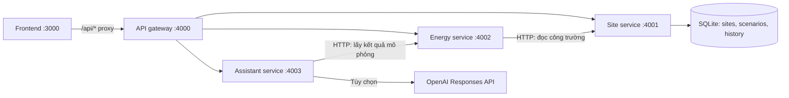

# GreenSite EMS

Ứng dụng mô phỏng năng lượng lai cho công trường, với frontend React/Next.js và **bốn backend service chạy độc lập qua HTTP**. Phép tính, báo cáo CSV và gọi AI nằm ở backend; frontend chỉ hiển thị, nhập cấu hình và gọi API.

## Deploy chung lên Vercel

Đã có `vercel.json` ở root để deploy frontend và bốn backend Services trong **một project**. Cloud đang dùng **demo chỉ đọc**, chưa cần database hosted: mô phỏng/CSV/trợ lý theo quy tắc hoạt động; nút lưu bị khóa và API không ghi dữ liệu tạm. Xem [hướng dẫn Vercel](docs/vercel-deployment.md).

## Chạy nhanh

Cần **Node.js 24+** và npm. Chạy lệnh tại **root repository**, không cài riêng trong `frontend/`:

```bash
npm ci
npm run dev
```

Mở http://127.0.0.1:3000. Launcher khởi động riêng từng service, đợi backend sẵn sàng rồi chạy frontend. Không cần OpenAI key để dùng mô phỏng và trợ lý theo quy tắc. Khi một process dừng bất thường, launcher dừng các process còn lại để tránh trạng thái nửa hoạt động.

Bản build production local:

```bash
npm run build
npm start
```

`npm run dev` build backend trước khi chạy. Khi sửa backend, khởi động lại lệnh này; frontend có hot reload. Mỗi service cũng có thể chạy riêng qua `npm run start:sites -w @greensite/backend`, `start:energy`, `start:assistant`, `start:gateway` sau khi build và cấu hình các biến môi trường.

## Ranh giới hệ thống



| Thành phần | Trách nhiệm | Sở hữu dữ liệu |
|---|---|---|
| Frontend | Layout, view, form, biểu đồ, trạng thái loading/lỗi | Chỉ state UI trong phiên |
| Gateway | Allowlist route/method, giới hạn body, chuyển tiếp, request ID | Không có database |
| Site service | Danh mục 3 công trường mẫu, cấu hình, phiên bản và lịch sử | SQLite riêng |
| Energy service | Điều phối mô phỏng, so baseline, cảnh báo, phát thải, CSV | Không giữ state |
| Assistant service | Phân tích theo quy tắc và OpenAI | Quota AI tạm trong process |
| Contracts package | DTO TypeScript và validation payload | Không chứa engine, seed hoặc secret |

Các service không import engine hoặc truy cập database của nhau. Assistant gọi Energy qua HTTP; Energy đọc công trường từ Site service. Mỗi service có entrypoint, port và Docker build target riêng. API gateway là gateway HTTP của ứng dụng; **không phải gateway/PLC điều khiển điện tại công trường**.

## Cấu trúc mã

```text
backend/
  common/                      HTTP transport, auth nội bộ, lifecycle
  services/
    gateway/                   Public API router
    sites/                     SQLite, schema v1, seed, versioned scenarios
    energy/                    Dispatch engine + CSV
    assistant/                 Rule analysis + OpenAI adapter
  tests/                       Unit + integration qua HTTP thật
  Dockerfile                   4 runtime targets
packages/contracts/            DTO/validation, dùng chung frontend/backend
frontend/
  components/ems/
    Dashboard.tsx              Điều phối state/UI
    layout/                    AppShell, Sidebar, Topbar
    views/                     Overview, Scenarios, Equipment, Alerts, Reports
    Assistant.tsx              Giao diện chat
    ui.tsx                     Panel, Metric, Comparison, Slider, Toggle
    Charts.tsx, Brand.tsx       Biểu đồ và nhận diện
  hooks/useWorkspace.ts        Tải/lưu/tính lại bất đồng bộ
  lib/api.ts                   API client tập trung
  lib/format.ts               Định dạng hiển thị
scripts/                       Launcher + đóng gói standalone UI
compose.yaml                   5 containers, network và volume
```

Không còn API handler nghiệp vụ ở `frontend/app/api/` hoặc engine trong frontend. Next.js chỉ rewrite `/api/*` sang gateway. `GATEWAY_URL` được chốt lúc build production; Docker build dùng `http://gateway:4000`, bản local dùng `http://127.0.0.1:4000`.

## Chạy bằng Docker Compose

```bash
cp -n .env.example .env
# Điền INTERNAL_SERVICE_TOKEN bằng chuỗi ngẫu nhiên dài ít nhất 32 ký tự.
# Có thể tạo bằng: openssl rand -hex 32

docker compose up --build -d
docker compose ps
```

UI ở cổng 3000, gateway ở cổng 4000, chỉ bind loopback. Site/Energy/Assistant chỉ mở trong network Docker. Database dùng named volume `site-data`, được giữ khi chạy `docker compose down` thông thường. Mỗi container backend chạy user `node`, có readiness healthcheck và xử lý SIGTERM.

Bản chạy bằng npm lưu ở `data/greensite.sqlite`; bản Docker lưu trong volume riêng. Hai môi trường không tự đồng bộ dữ liệu. Docker Compose là cấu hình chạy local, chưa phải deployment multi-tenant công khai.

## Kịch bản được lưu trên server

`GET /api/sites/:id/scenario` trả cấu hình, cấu hình gốc và `revision`. Khi lưu, client gửi `expectedRevision`. Site service ghi cấu hình và lịch sử trong một transaction. Phiên đã cũ nhận **409 REVISION_CONFLICT**, không ghi đè âm thầm.

Frontend hủy request cũ khi đổi công trường/cấu hình, debounce phép tính và đánh dấu kết quả cũ trong lúc chờ máy chủ. Khi service lỗi, UI hiển thị lỗi và nút thử lại; không tự thay bằng số liệu giả trên trình duyệt. Export và chat chờ kết quả mới để tránh dùng nhầm kịch bản.

Các cấu hình localStorage của MVP cũ không bị xóa nhưng không tự nhập vào database. Lịch sử server giữ các lần lưu; API trả tối đa 20 phiên bản gần nhất. Database hiện là single-writer SQLite, chưa thiết kế để nhiều replica Site service cùng ghi.

## API

| API gateway | Phương thức | Nội dung |
|---|---|---|
| `/api/sites` | GET | Danh mục công trường từ DB |
| `/api/sites/:id` | GET | Metadata công trường |
| `/api/sites/:id/scenario` | GET / PUT | Đọc / lưu `{ config, expectedRevision }` |
| `/api/sites/:id/history` | GET | 20 lần lưu gần nhất |
| `/api/simulate` | POST | `{ siteId, config }` → mô phỏng 96 bước |
| `/api/compare` | POST | `{ siteId, reference, candidate }` → so sánh hai cấu hình trên backend |
| `/api/reports/export` | POST | `{ siteId, config }` → CSV UTF-8 có BOM |
| `/api/assistant` | GET / POST | Trạng thái / `{ siteId, config, mode, question, history? }` |
| `/health/live` | GET | Process gateway đang sống |
| `/health/ready` | GET | Kiểm tra các dependency thực sự sẵn sàng |

API nội bộ nằm dưới `/v1/*`, yêu cầu `X-Service-Token`. Health liveness được phép đọc không cần token; readiness của service nội bộ vẫn cần token. Request ID được truyền qua các service và trả ở `X-Request-Id`; log chỉ ghi request ID, method/path, status và thời gian, không ghi nội dung chat hoặc credentials. Body JSON bị giới hạn 20 KB; các request đến service phụ thuộc có timeout.

## AI tùy chọn

Tạo `.env` tại root (không commit):

```dotenv
INTERNAL_SERVICE_TOKEN=<chuỗi ngẫu nhiên tối thiểu 32 ký tự>
OPENAI_API_KEY=<API key của bạn>
OPENAI_MODEL=<model khả dụng trong OpenAI project của bạn>
AI_ACCESS_TOKEN=<mã truy cập riêng cho chế độ AI demo>
```

Khởi động lại hệ thống. Trong tab Trợ lý AI, chọn OpenAI và nhập **AI_ACCESS_TOKEN**, không nhập OpenAI API key. Launcher/Compose chỉ đưa biến OpenAI vào Assistant service; frontend không nhận API key hoặc token nội bộ.

Assistant tự gọi Energy service để lấy số liệu chuẩn, không tin tổng số do client gửi. Chỉ khi chọn OpenAI và gửi câu hỏi, service mới gửi dữ liệu mô phỏng, câu hỏi và tối đa 6 lượt gần nhất đến Responses API, dùng `store: false`. Chế độ `local` là phân tích theo quy tắc **trên backend**, không phải AI sinh văn bản hay tính toán trong trình duyệt.

Quota demo là 20 yêu cầu AI/giờ/process. Đây chưa phải quota phân tán hay xác thực người dùng. AI không có tool điều khiển thiết bị. Gọi OpenAI thật cần key và hạn mức của bạn; tests dùng transport giả lập, không phát sinh phí API.

Tài liệu API: https://developers.openai.com/api/docs/guides/text

## Kiểm thử

```bash
npm test
npm run typecheck
npm run format:check
npm run build
```

Kiểm thử gồm 144 tổ hợp biên về cân bằng năng lượng/SOC/công suất; HTTP giữa service; auth nội bộ; validation; CSV; persistence qua restart; version conflict; OpenAI mock; quota và dependency outage. Integration tests dùng database tạm riêng.

Smoke test trình duyệt: mở Chromium bằng một profile riêng, khởi động toàn hệ thống ở cổng 3000, rồi chạy:

```bash
chromium --headless --disable-gpu --remote-debugging-port=9225 --user-data-dir=/tmp/greensite-browser about:blank
npm run test:browser
```

Test dùng hai công trường mẫu, lưu/thử cấu hình và khôi phục giá trị ban đầu nếu phiên bản chưa bị người khác thay đổi. Lịch sử revision vẫn ghi nhận các lần lưu của test. Không chạy smoke test trên môi trường production.

## Giới hạn mô hình và sản phẩm

- Dữ liệu công suất/thời tiết vẫn là mô phỏng 96 bước × 15 phút, ngày mẫu 05/11/2026. Có backend/database không đồng nghĩa đã kết nối thiết bị thật.
- Baseline dùng cùng PV và tổng nhu cầu nhưng không điều phối pin/dịch tải; nếu thiếu tải hoặc baseline bằng 0, không công bố tỷ lệ tiết kiệm.
- Pin khởi đầu tại SOC dự phòng, tối đa 95%, hiệu suất mỗi chiều 95%. Tồn năng lượng cuối ngày hiển thị riêng, không tự ghi có thành tiết kiệm.
- Diesel chỉ dự phòng khi mất lưới; mô hình giả định tải tối thiểu 30%, chưa có thời gian khởi động/quá độ. Zero-Export chỉ là ràng buộc trong mô hình, không phải chứng minh bảo vệ điện thực tế.
- Chi phí gồm điện nhập, diesel và hao mòn pin; chưa có CAPEX, thuế, phí công suất hay doanh thu xuất điện. Hệ số điện lưới 0,6592 kg CO₂e/kWh, diesel 2,68 kg/lít, tiêu hao 0,28 lít/kWh và hao mòn 350 ₫/kWh xả đều là giả định demo.
- Chưa có đăng nhập, tenant/RBAC, CRUD công trường tùy ý, MQTT/telemetry, hàng đợi hoặc PLC/edge. API public hiện dành cho workspace local chung; không triển khai public trước khi có lớp auth và quota phù hợp.

Bộ nhận diện và artwork được giữ nguyên: [Brand identity](docs/brand-identity.md). Xem thêm [kiến trúc](docs/greensite-ems-architecture.md) và [đặc tả](docs/greensite-ems-specs.md).

## Thử và giữ phương án năng lượng

Trang Kịch bản có ba mẫu: tận dụng mặt trời, mất lưới giờ cao điểm và ít nắng/tải cao. Mỗi mẫu thay toàn bộ tham số dựa trên cấu hình gốc của công trường.

Ghim cấu hình làm mốc để so sánh chi phí, carbon và tải chưa phục vụ với phương án hiện tại. Backend tính cả hai phương án; không kết luận tỷ lệ tiết kiệm khi đổi tải, thời tiết, điều kiện mất lưới, biểu giá hoặc có tải chưa phục vụ. Mốc chỉ giữ trong phiên, xóa khi đổi công trường hoặc tải lại trang; chưa tính CAPEX hay giá trị pin cuối ngày.

Nhập/Xuất cấu hình dùng tệp `.greensite.json` trên máy, không lưu vào cloud. Tệp tối đa 20 KB, có phiên bản định dạng; chỉ nhập cho đúng công trường đang chọn và kiểm tra toàn bộ tham số trước khi áp dụng.
